# Тарих Guessr

**Угадай год и место по историческому снимку — и узнай, что тогда произошло.**

Веб-игра об истории Казахстана для Republic Day Hackathon, трек 1 «Тарих тірілді». Игрок видит настоящую архивную фотографию, картину или документ, ставит год на ползунке и точку на карте Казахстана, а потом читает разбор события с источниками. Кроме игры есть интерактивная карта истории от саков до наших дней, ИИ-гид и пешеходный квест по Семею. Интерфейс на казахском, русском и английском.

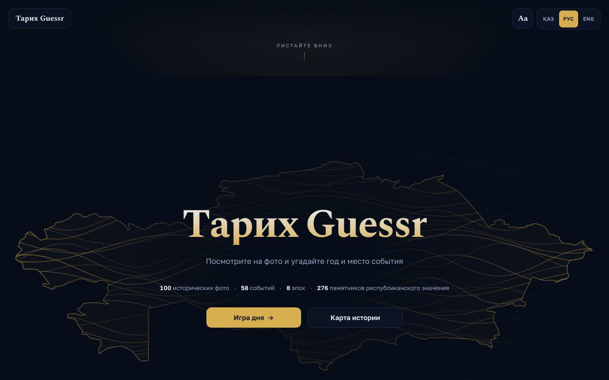

| | |
|---|---|
| **100** исторических снимков 1848–2025 годов | **58** событий от VIII века до н. э. до 1997 года |
| **8** эпох на карте с контурами территорий | **276** памятников республиканского значения (госсписок 2025) |
| **6** режимов игры и изучения | **3** языка: қазақша, русский, English |

## Содержание

- [Запуск на своём компьютере](#запуск-на-своём-компьютере)
- [Как проверить, что всё работает (путь пользователя)](#как-проверить-что-всё-работает-путь-пользователя)
- [Где хранятся данные и как проверить, что они сохраняются](#где-хранятся-данные-и-как-проверить-что-они-сохраняются)
- [Режимы игры](#режимы-игры)
- [Карта истории](#карта-истории)
- [ИИ-гид](#ии-гид)
- [Квест по Семею](#квест-по-семею)
- [Подсчёт очков](#подсчёт-очков)
- [Контент и проверка фактов](#контент-и-проверка-фактов)
- [Открытые данные и источники](#открытые-данные-и-источники)
- [Технологии и устройство проекта](#технологии-и-устройство-проекта)
- [Команды](#команды)
- [Деплой на Vercel](#деплой-на-vercel)
- [Как добавить карточку](#как-добавить-карточку)
- [Известные ограничения](#известные-ограничения)

---

## Запуск на своём компьютере

### Что нужно

- **Node.js 20 или новее** (проверить: `node -v`) и npm, который идёт вместе с ним. Tailwind CSS 4 на Node 18 не запустится.
- **Интернет**: подложки карт (спутник Esri, рельеф AWS, улицы OpenStreetMap) и шрифты Google Fonts загружаются из сети. Сама игра и все данные лежат в репозитории.
- Python 3 — только для проверки и импорта контента (`scripts/`), для запуска игры не нужен.

### Запуск за три команды

```bash
git clone https://github.com/Amir411111/Republic_Day.git
cd Republic_Day
npm install
npm run dev
```

Откройте **http://localhost:5173** в браузере. Всё готово: база данных, регистрация и ключи не нужны.

### Тестовые данные

Отдельно готовить тестовые данные не нужно — весь контент игры лежит в репозитории и подхватывается автоматически:

| Файл | Что внутри |
|---|---|
| `content/cards.json` | 100 карточек с фото: год, место, тексты на трёх языках, источники, автор и лицензия фото |
| `content/images/` | сами фотографии (93 локально, 7 подгружаются с Wikimedia Commons) |
| `content/events.json` | 58 событий для карты истории и режимов «Ханы и битвы» и «Вид со спутника» |
| `content/periods.json`, `content/geo/` | 8 эпох, их контуры, граница и области Казахстана |
| `content/regions.json` | заметки по областям с источниками |
| `content/monuments.json` | 276 памятников Государственного списка памятников республиканского значения (2025) |
| `content/quest-semey.json` | 9 остановок квеста по Семею |

Прогресс игрока хранится в браузере (localStorage), поэтому каждый проверяющий начинает «с нуля» и ничего не нужно сбрасывать на сервере.

### Продакшн-сборка (как на сайте)

```bash
npm run build      # проверка типов TypeScript + сборка в dist/
npm run preview    # http://localhost:4173
```

### ИИ-гид локально (необязательно)

Без ключа гид работает в офлайн-режиме: ищет ответ в базе игры прямо в браузере и честно пишет, что ИИ недоступен. Чтобы включить настоящие ответы ИИ (Claude или OpenAI), создайте в корне проекта файл `.env.local` (он в `.gitignore` и не попадёт в репозиторий):

```bash
ANTHROPIC_API_KEY=sk-ant-...
# или ключ OpenAI:
OPENAI_API_KEY=sk-...
# необязательно, модель OpenAI (по умолчанию gpt-5.5):
OPENAI_MODEL=gpt-5.5
# или бесплатный ключ Google AI Studio (Gemini):
GEMINI_API_KEY=...
# необязательно, модель Gemini (по умолчанию gemini-3-flash-preview):
GEMINI_MODEL=gemini-3-flash-preview
```

Если задано несколько ключей, используется первый по порядку: Claude, OpenAI, Gemini.

и перезапустите `npm run dev`. Ключ читается только на стороне сервера разработки (`vite.config.ts` отдаёт `api/guide.ts` по адресу `/api/guide`, как Vercel на проде) и никогда не попадает в браузер. В `npm run preview` гид всегда работает офлайн.

### Если что-то не запускается

| Симптом | Что сделать |
|---|---|
| предупреждение `EBADENGINE` при `npm install` или ошибки Tailwind при запуске | обновите Node.js до 20+ |
| Карта серая, «Не удалось загрузить карту» | нужен интернет: подложка грузится с серверов Esri и AWS |
| Порт 5173 занят | `npm run dev -- --port 3000` |
| Хочу начать игру заново | в консоли браузера `localStorage.clear()` и обновить страницу |

---

## Как проверить, что всё работает (путь пользователя)

Сценарий на 10–15 минут, который проходит по всем функциям. Справа — что должно получиться.

| # | Действие | Ожидаемый результат |
|---|---|---|
| 1 | Откройте http://localhost:5173 и прокрутите вниз | «Тоннель» из фотографий, затем заставка с цифрами и кнопками «Игра дня» и «Карта истории» |
| 2 | Переключите язык (ҚАЗ / РУС / ENG) в правом верхнем углу и **обновите страницу** | Весь интерфейс на выбранном языке; после перезагрузки язык **сохранился** |
| 3 | Нажмите «Тарих Guessr» вверху слева | Страница прокручивается к блоку «Режимы» |
| 4 | Нажмите **«Игра дня»** | Раунд 1 из 5: слева фото, справа спутниковая карта без подписей, внизу ползунок года |
| 5 | Передвиньте год (ползунок или ±1/±10), поставьте точку на карте, нажмите «Ответить» | На карте появляется правильное место и пунктир до вашей точки; внизу — расстояние, разница в годах и очки; слева — разбор, подсказка, источники, автор фото |
| 6 | Пройдите все 5 раундов, нажмите «К итогам» | Итог из 1000 очков, цветные квадраты по раундам, кнопка «Поделиться» копирует результат |
| 7 | Откройте игру дня в другом браузере или в режиме инкогнито | Те же 5 снимков, что и в первом браузере: игра дня одинакова у всех в течение суток |
| 8 | Вернитесь на главную → **«Повторить ошибки»** | Снимки, за которые вы получили меньше 100 из 200 очков (прогресс **сохранился**). Если ошибок нет — сообщение «Пока нет ошибок для повторения» |
| 9 | **«Ханы и битвы»** | Раунды без фото: название события (часто с портретом или гравюрой), нужно угадать год и место |
| 10 | **«Вид со спутника»** | Место события в 3D с рельефом, без подписей; угадать, где и когда это было |
| 11 | **«Карта истории»** | 3D-карта, внизу таймлайн из 8 эпох. Переключайте эпохи стрелками ← → или кликом; кнопка «Демо» листает их сама |
| 12 | На карте кликните на ромб или кружок | Карточка события: год, место, текст, источники, картинка, кнопка «Спросить гида» |
| 13 | Включите слой «Памятники республиканского значения» | 276 памятников по всему Казахстану; цвет — класс памятника, над слоями фильтры по классам. Клик — название, класс, местонахождение, ссылка на источник и, если на Wikimedia Commons есть свободное фото объекта, фотография с автором и лицензией |
| 14 | Выберите эпоху «Современный Казахстан» и кликните на область | Область поднимается, панель с историей области, реформами 2018/2022 и источниками |
| 15 | **«ИИ-гид»** → нажмите пример вопроса | Ответ на выбранном языке (без ключа — найденные в базе игры события с пометкой об офлайн-режиме) |
| 16 | **«Квест по Семею»** → ответьте на вопрос первой остановки, затем **обновите страницу** | Остановка отмечена зелёным, счётчик «Пройдено: 1 из 5» **сохранился** после перезагрузки |
| 17 | Откройте игру на телефоне или в мобильном режиме DevTools (ширина 390 px) | Все экраны помещаются по ширине, кнопки не меньше 48 px |

---

## Где хранятся данные и как проверить, что они сохраняются

Сервера с базой данных у игры нет: контент лежит в `content/`, а прогресс игрока — в `localStorage` браузера. Это осознанное решение: игра работает без регистрации, сразу на любом устройстве, и ничего не собирает о пользователе.

| Ключ в localStorage | Что хранит | Когда меняется |
|---|---|---|
| `tg_lang` | выбранный язык: `kk`, `ru` или `en` | при переключении языка |
| `tg_progress_v1` | результат по каждой карточке: число игр, лучший и последний счёт, дата | после каждого ответа в любом режиме |
| `tg_quest_semey_v1` | список пройденных остановок квеста | при правильном ответе или «Я на месте» |
| `tg_terrain` | включён ли 3D-рельеф на карте истории (`1` / `0`) | при нажатии «3D-рельеф» |

**Как посмотреть.** Chrome / Edge: DevTools (F12) → Application → Local Storage → `http://localhost:5173`. Firefox: DevTools → Storage → Local Storage. Или в консоли:

```js
JSON.parse(localStorage.getItem('tg_progress_v1'))
// { "turksib-last-spike-1930": { plays: 1, best: 142, last: 142, lastPlayed: "2026-10-20T…" }, … }
```

**Как сбросить:** `localStorage.clear()` в консоли и обновить страницу, либо кнопка «Начать квест заново» для квеста.

Режим «Повторить ошибки» берёт карточки, у которых последний результат ниже 100 из 200 очков (`src/progress/storage.ts`).

---

## Режимы игры

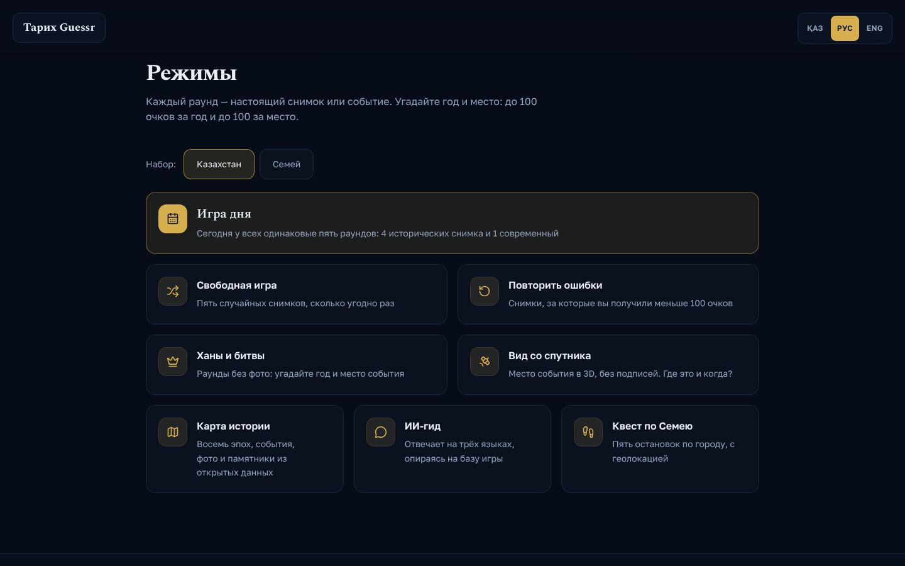

### Игра дня

Пять раундов, одинаковых для всех игроков в течение суток: четыре исторических снимка и один современный (2001 год и позже). Набор выбирается детерминированно по дате и набору карточек (`src/game/pick.ts`), поэтому результатами можно честно меряться с друзьями — кнопка «Поделиться» копирует счёт и цветные квадраты.

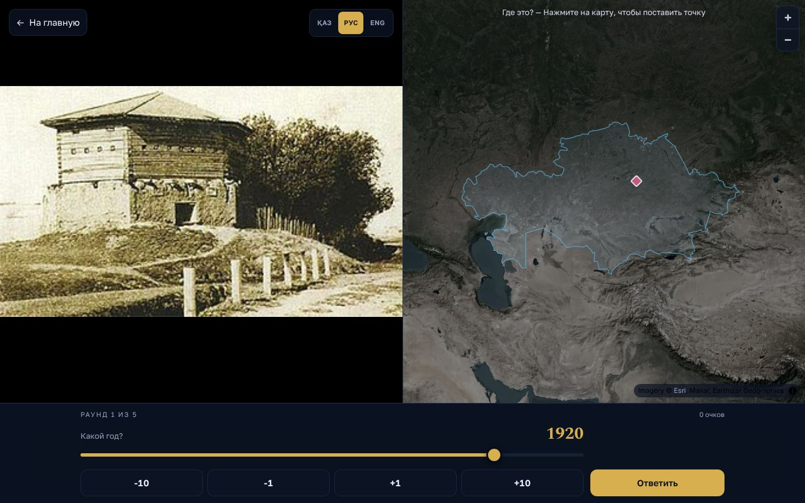

После ответа — правильное место на карте, расстояние, разница в годах и разбор: что на снимке, по каким деталям можно было догадаться, источники и автор фото.

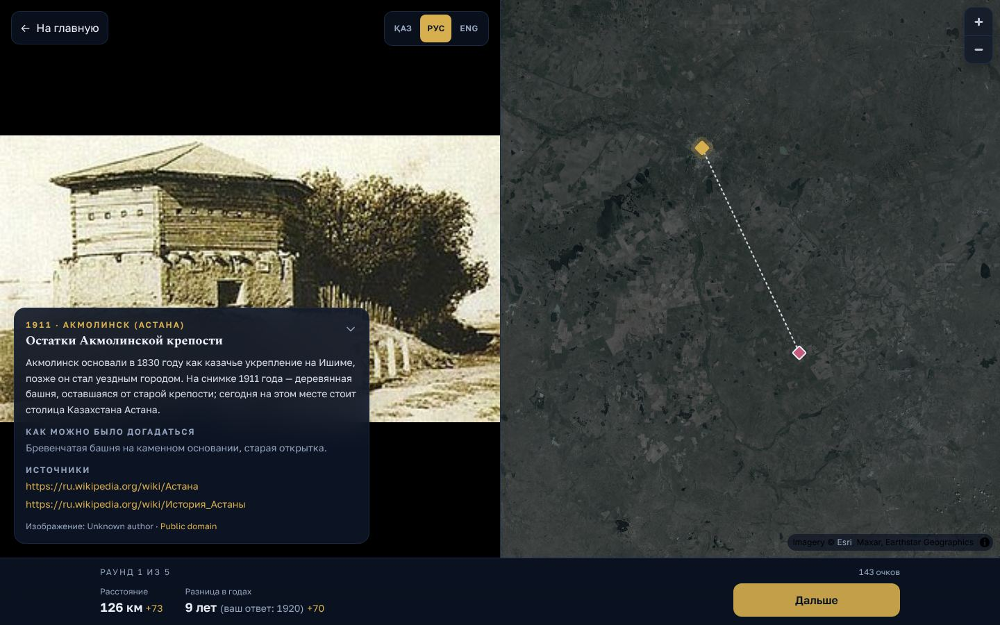

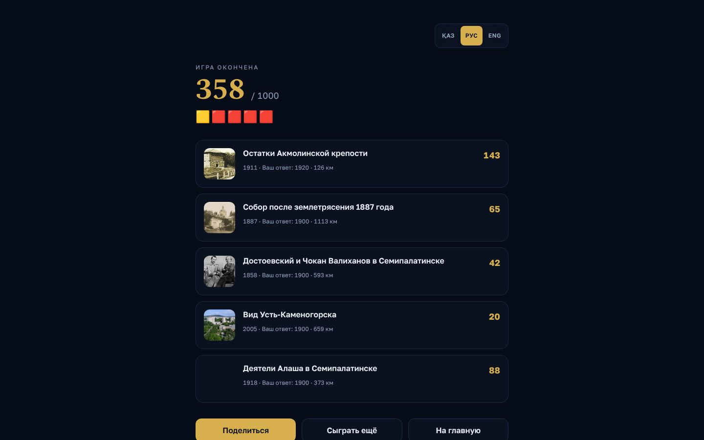

### Свободная игра и наборы

Пять случайных снимков, сколько угодно раз. Над режимами можно выбрать набор: **Казахстан** (все 100 карточек) или **Семей** (10 карточек о городе).

### Повторить ошибки

Снимки, за которые вы получили меньше 100 из 200 очков. Работает по сохранённому прогрессу (см. выше).

### Ханы и битвы

Раунды без фотографий: на экране название события до 1900 года — основание Казахского ханства, Жеті Жарғы, Аныракайская битва, Абулхаир, восстание Исатая и Махамбета и другие (20 событий). Где есть, показан портрет, гравюра или документ эпохи. Нужно угадать год и место.

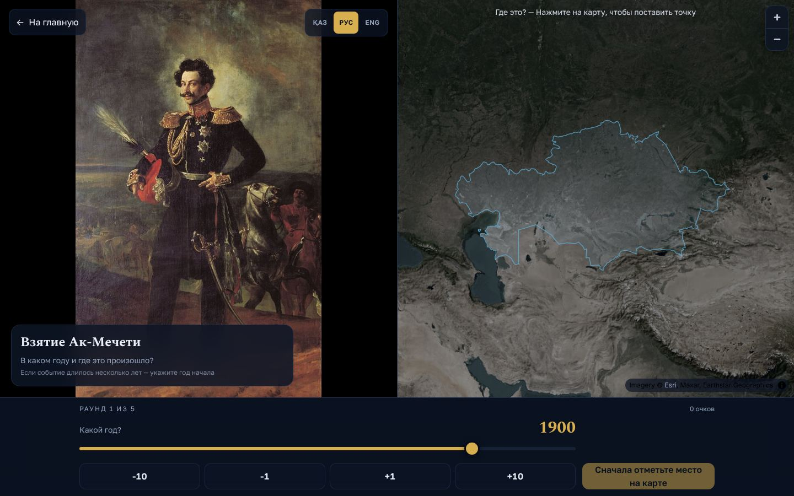

### Вид со спутника

Место события показано в 3D со спутника с настоящим рельефом и без подписей; камера под своим углом для каждого события. В режим попадают только 35 событий с точно известным местом.

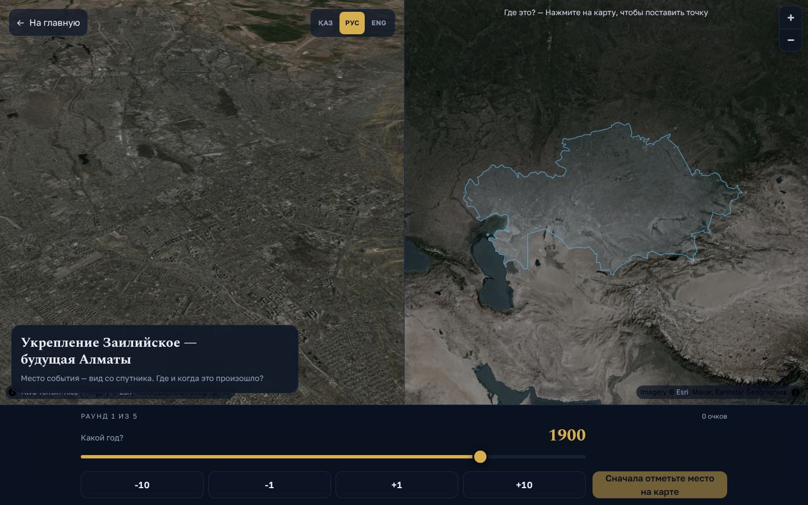

---

## Карта истории

Полноэкранная 3D-карта на спутниковой подложке с рельефом. Внизу таймлайн из восьми эпох: саки, тюркские каганаты, Караханиды и кипчаки, монголы и Золотая Орда, Казахское ханство, Российская империя, советский период, современный Казахстан. При смене эпохи камера перелетает к её территории, а контур эпохи плавно сменяется.

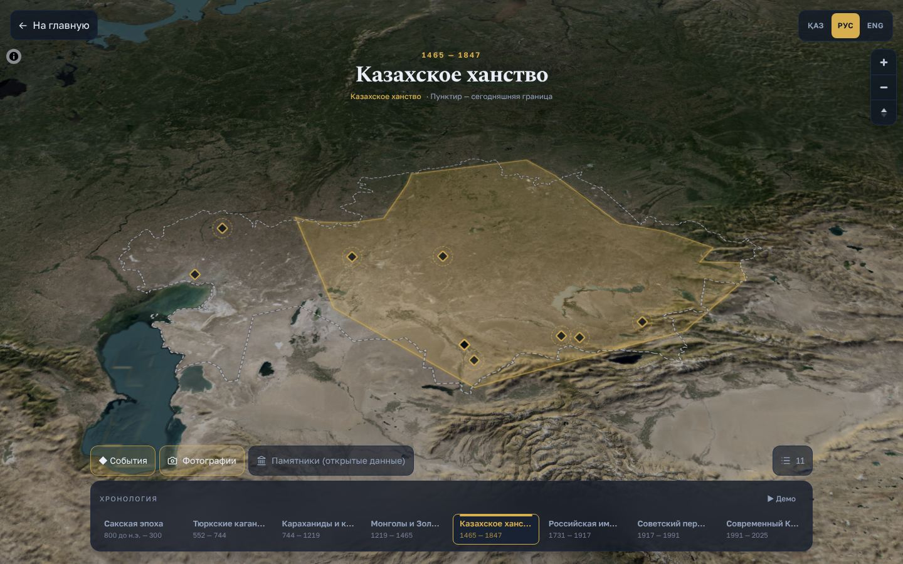

- **Ромбы** — события (пунктирное кольцо вокруг ромба: место известно примерно), **кружки** — исторические фотографии.
- Клик по точке открывает карточку: год, место, текст, картинка, источники и кнопка «Спросить гида» об этом событии.
- Кнопка со счётчиком открывает список всех событий эпохи.
- Пунктир — сегодняшняя граница Казахстана; в эпохи империи и СССР нынешняя территория подсвечена голубым.
- Клавиши ← → переключают эпохи, «Демо» листает их автоматически — удобно для презентации на проекторе.
- Кнопка «3D-рельеф» включает и выключает объёмный рельеф: он самая тяжёлая часть карты, поэтому по умолчанию включён только на больших экранах, а выбор запоминается в браузере.

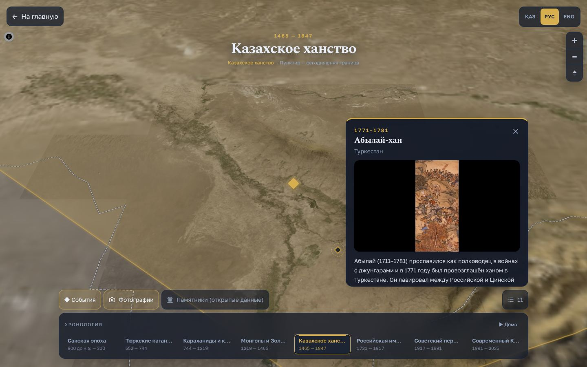

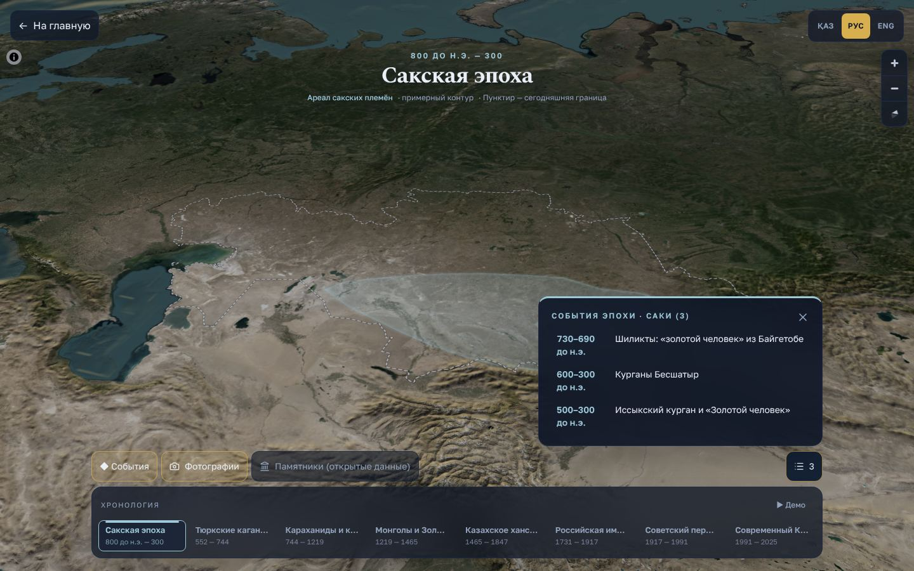

**Памятники республиканского значения.** Слой «Памятники» показывает самые значимые памятники страны — те, что включены в **Государственный список памятников истории и культуры республиканского значения** (приказ Министра культуры и информации от 11.07.2025 № 318-НҚ, ИПС «Әділет»): мавзолеи Ходжи Ахмеда Ясави, Арыстан-баба и Айша-Биби, городища Отырар и Тараз, подземные мечети Бекет-ата, Вознесенский собор в Алматы и другие, по всем областям и городам. Цвет точки — класс памятника (археология, архитектура, монументальное искусство, ансамбли, сакральные объекты), над слоями — фильтры по классам с количеством.

В самом списке координат нет, только адреса и описания, поэтому каждый памятник найден по данным OpenStreetMap: сначала сам объект по названию в своей области (и в своём районе, если район указан), затем в Wikidata, затем здание по адресу (улица и номер дома — такая точка тоже точная), иначе — улица из адреса или населённый пункт из описания («в 5 км к северу от села …»). Такие примерные точки нарисованы полыми кольцами, в карточке это написано и приведено исходное описание из списка; их можно скрыть кнопкой «Примерные места». Импорт — `scripts/import_monuments.py`. При подборе данных о памятниках мы использовали портал открытых данных [data.egov.kz](https://data.egov.kz).

**Фото памятников.** Когда открывается карточка памятника, браузер ищет объект в Wikidata и берёт его фото с Wikimedia Commons — с автором и лицензией. Фото показывается, только если найденный объект того же типа (мавзолей — мавзолей), его название совпадает и он стоит рядом с точкой на карте; иначе карточка остаётся без фото. Если Wikimedia недоступна, карточка работает как обычно.

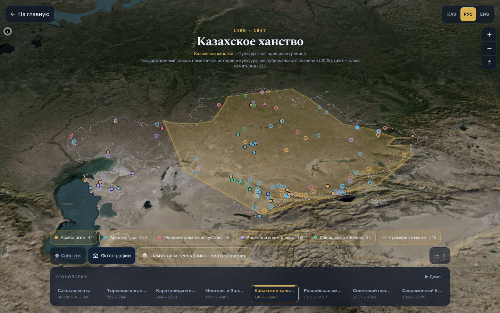

**Области.** В эпохе «Современный Казахстан» области подняты блоками; клик по области — её роль в истории, связанные эпохи и изменения административного деления 2018 и 2022 годов.

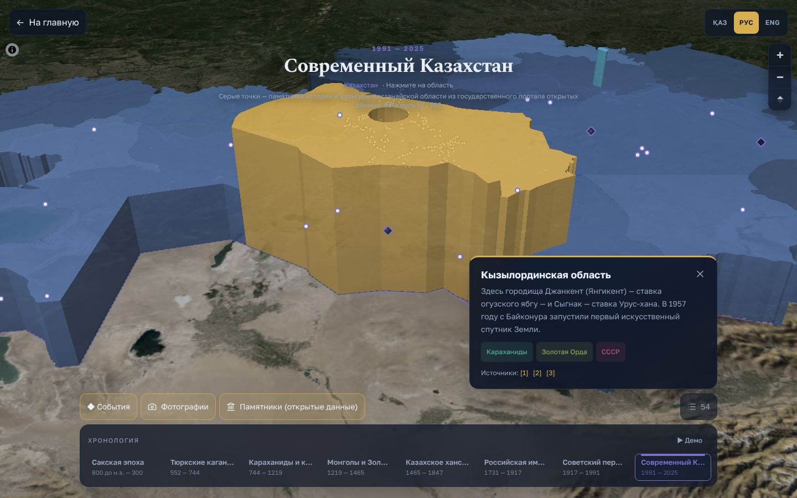

---

## ИИ-гид

Чат, который отвечает на вопросы по истории Казахстана на языке игрока. Гид работает на Claude (`api/guide.ts`, серверная функция Vercel) и опирается на базу игры: все события и карточки передаются ему как справочник, а в системных инструкциях прямо запрещено придумывать даты, имена и цитаты — если историки спорят, гид должен так и сказать. Из карточки события на карте гида можно спросить именно об этом событии.

Если ключ API не настроен или сеть недоступна, гид не ломается: он ищет подходящие события в базе игры прямо в браузере и показывает их с пометкой «ИИ-гид сейчас недоступен».

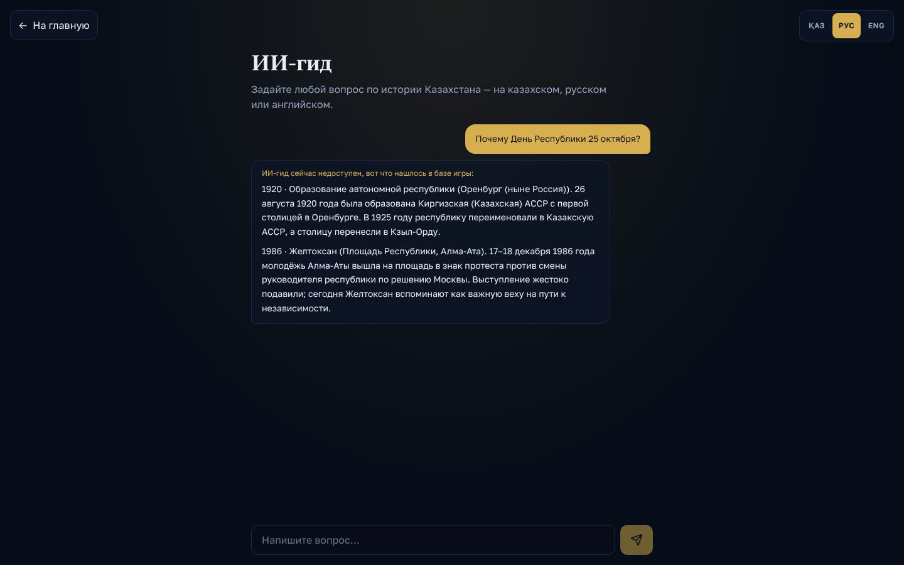

## Квест по Семею

Пешеходный маршрут из девяти остановок по историческому центру Семея: Ямышевские ворота, дом губернатора (краеведческий музей), музей Достоевского, дом Анияра Молдабаева, медресе Ахмета Ризы, музей Абая, памятник Шакариму, Двухминаретная мечеть, монумент «Сильнее смерти». Четыре из них — памятники республиканского значения из госсписка. На каждой остановке — история места и задания разных типов: вопрос с вариантами, «угадай год» на ползунке, вопрос «найдите на месте», ответ на который виден только у самого здания; у музея Достоевского — архивный снимок 1858 года. За верный ответ с первой попытки и за отметку «Я на месте» (геолокация, ближе 150 м) даются звёзды, в конце — итог, которым можно поделиться. Кнопка «Следующая остановка» и клик по точке на карте ведут к нужной карточке. Прогресс сохраняется в браузере.

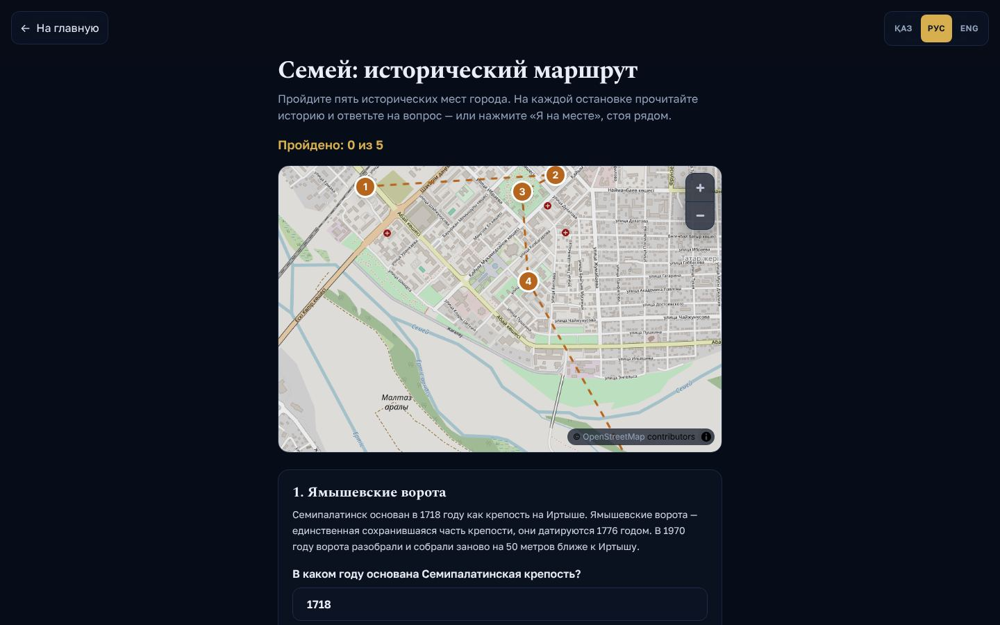

## Мобильная версия

Интерфейс сначала проектировался для телефона: кнопки от 48 px, крупный шрифт, разбор ответа на телефоне открывается свёрнутым, чтобы не закрывать снимок.

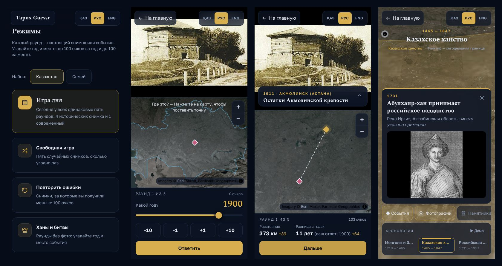

---

## Подсчёт очков

За раунд — до 100 очков за год и до 100 за место, за игру из пяти раундов — до 1000.

- **Год:** `round(100 × e^(−|Δлет| / 25))` — ошибка в 10 лет даёт 67 очков, в 25 лет — 37, в 50 лет — 14.
- **Место:** `round(100 × e^(−км / 400))` — 100 км дают 78 очков, 400 км — 37, 1000 км — 8. Расстояние считается по формуле гаверсинусов (`src/map/distance.ts`).
- Ползунок года: 1400–2025.

---

## Контент и проверка фактов

Главное правило проекта: **никаких выдуманных дат, фактов и источников**.

- Каждая карточка содержит источники и строку `verified_by` — кто проверил факты. Карточка без источников, автора и лицензии фото или без проверки в игру не попадает (её видно только в режиме разработки: `npm run dev` или `?dev=1` в адресе).
- Только настоящие фотографии, картины и документы со свободной лицензией (public domain, CC BY, CC BY-SA) с Wikimedia Commons; автор и лицензия показаны под каждым снимком. Никаких картинок, сгенерированных ИИ. На снимках не должно быть подписи с годом — такие кадры обрезались или не брались.
- Если историки расходятся в дате (например, Аныракайская битва — 1729 или 1730), это написано в тексте, а не скрыто.
- События, место которых известно лишь примерно, помечены `approx: true` и на карте отличаются пунктирным кольцом.
- Скрипт `python3 scripts/validate.py` проверяет все карточки и события: обязательные поля на трёх языках, координаты внутри Казахстана, наличие файлов фото, источников и лицензий.

## Открытые данные и источники

| Источник | Что взято | Лицензия |
|---|---|---|
| [ИПС «Әділет»](https://adilet.zan.kz/rus/docs/G25KS000318) | Государственный список памятников истории и культуры республиканского значения (2025) | официальный акт |
| [data.egov.kz](https://data.egov.kz/datasets/view?index=respublikalyk_manyzy_bar_tarih) | портал открытых данных: использовали при подборе данных о памятниках | открытые данные |
| [OpenStreetMap / Nominatim](https://nominatim.org) | координаты памятников из списка | ODbL |
| [Wikidata](https://www.wikidata.org) | поиск фото памятников | CC0 |
| [Wikimedia Commons](https://commons.wikimedia.org) | исторические фото, картины, документы | PD / CC BY / CC BY-SA, автор в каждой карточке |
| Wikipedia, e-history.kz и др. | источники фактов, ссылки в каждой карточке | — |
| [Natural Earth](https://www.naturalearthdata.com) | граница и области Казахстана | public domain |
| [historical-basemaps](https://github.com/aourednik/historical-basemaps) | исторические территории | GPL-3.0 |
| Esri World Imagery | спутниковая подложка | Esri, Maxar |
| [AWS Terrain Tiles](https://registry.opendata.aws/terrain-tiles/) | высоты для 3D-рельефа | открытые данные |
| [OpenStreetMap](https://www.openstreetmap.org/copyright) | карта улиц для квеста | ODbL |


---

## Технологии и устройство проекта

- **Фронтенд:** Vite 6, React 18, TypeScript (strict), Tailwind CSS 4, framer-motion, иконки lucide-react.
- **Карты:** MapLibre GL через react-map-gl — 3D-рельеф, контуры эпох, слои GeoJSON. Подложки без ключей API. Экраны с картами подгружаются отдельно, поэтому главная открывается быстро.
- **ИИ-гид:** Claude API (`@anthropic-ai/sdk`), серверная функция Vercel `api/guide.ts`; ключ только в переменных окружения сервера.
- **Данные:** JSON-файлы в `content/`, прогресс игрока в `localStorage`. Сервера с базой данных нет.
- **Языки:** все тексты интерфейса — в `src/i18n/strings.ts` (ключ → kk/ru/en), тексты контента — в самих JSON-файлах.

```
api/guide.ts            ИИ-гид (серверная функция Vercel)
content/                весь контент игры; Vite отдаёт папку как статику
  cards.json            100 карточек с фото
  events.json           58 событий карты истории
  periods.json          8 эпох (названия, цвета, ракурс камеры)
  regions.json          заметки по областям
  quest-semey.json      маршрут квеста
  monuments.json        памятники республиканского значения (+ monuments-meta.json — счётчики)
  tunnel.json           фото для заставки на главной
  geo/                  контуры эпох, граница и области (GeoJSON)
  images/               фотографии
  schema.json           JSON Schema карточки
scripts/
  validate.py           проверка карточек и событий
  fetch_commons.py      скачать фото с Commons и получить блок image_credit
  import_monuments.py   импорт списка памятников республиканского значения
src/
  App.tsx               переключение экранов и режимов
  landing/              главная: тоннель, заставка, режимы, разделы
  game/                 игра: раунд, разбор, итоги, очки, выбор карточек
  atlas/                карта истории: эпохи, таймлайн, слои, панели
  map/                  карта для ответа, 3D-вид, стили подложек, расстояние
  guide/                ИИ-гид и офлайн-поиск по базе
  quest/                квест по Семею
  progress/             сохранение прогресса в localStorage
  i18n/                 тексты интерфейса на трёх языках
  ui/                   кнопки, переключатель языка, общие компоненты
  styles/app.css        тема: цвета, шрифты, стили карт
docs/screenshots/       скриншоты для этого README
```

## Команды

| Команда | Что делает |
|---|---|
| `npm install` | установить зависимости |
| `npm run dev` | сервер разработки на http://localhost:5173 (видны и непроверенные карточки) |
| `npm run build` | проверка типов TypeScript и сборка в `dist/` |
| `npm run preview` | запустить собранную версию на http://localhost:4173 |
| `python3 scripts/validate.py` | проверить карточки и события (`--draft` — не считать ошибкой пустой `verified_by`) |
| `python3 scripts/fetch_commons.py "File:Name.jpg"` | скачать фото с Wikimedia Commons и получить блок `image_credit` |
| `python3 scripts/import_monuments.py [--geocode]` | собрать `content/monuments.json` из республиканского списка (`--geocode` — искать в OpenStreetMap то, чего нет в кэше `scripts/geocode-cache.json`) |

## Деплой на Vercel

1. Импортируйте репозиторий в Vercel — фреймворк Vite определится автоматически (build: `npm run build`, output: `dist`).
2. В Settings → Environment Variables добавьте один из ключей: `ANTHROPIC_API_KEY`, `OPENAI_API_KEY` или `GEMINI_API_KEY` (Google AI Studio) — без ключа гид работает в офлайн-режиме; модель можно задать в `OPENAI_MODEL` / `GEMINI_MODEL`.
3. `vercel.json` уже включает `content/events.json` и `content/cards.json` в серверную функцию гида.

Непроверенные карточки на проде можно посмотреть, добавив к адресу `?dev=1`.

## Как добавить карточку

1. Найдите фото на Wikimedia Commons со свободной лицензией и без подписи с годом.
2. `python3 scripts/fetch_commons.py "File:Имя_файла.jpg"` — скрипт скачает фото в `content/images/` и выдаст блок `image_credit`.
3. Добавьте карточку в `content/cards.json` по формату ниже (полная схема — `content/schema.json`).
4. Проверьте факты по источникам и впишите своё имя в `verified_by`.
5. `python3 scripts/validate.py` и `npm run build`.

```json
{
  "id": "example-semey",
  "pack": ["kz", "semey"],
  "year": 1900,
  "lat": 50.41,
  "lng": 80.23,
  "place": { "kk": "Семей", "ru": "Семей", "en": "Semey" },
  "image": "images/example-semey.jpg",
  "image_credit": { "author": "…", "license": "Public domain", "source_url": "https://commons.wikimedia.org/wiki/File:…" },
  "title": { "kk": "…", "ru": "…", "en": "…" },
  "explanation": { "kk": "2–3 сөйлем", "ru": "2–3 предложения", "en": "…" },
  "clue": { "kk": "…", "ru": "По каким деталям догадаться", "en": "…" },
  "sources": ["https://…"],
  "difficulty": 2,
  "verified_by": "имя проверившего"
}
```

## Известные ограничения

- Казахские тексты ещё проверяет носитель языка.
- 7 фотографий подгружаются напрямую с Wikimedia Commons (их не удалось скачать из-за ограничения частоты запросов); при блокировке Commons они не покажутся.
- Для каждого контура эпохи ещё не записано, из какого именно слоя historical-basemaps он взят (`content/geo/README.md`).
- Часть памятников стоит примерно (по улице или селу из описания) — такие точки нарисованы кольцами.
- Фото памятников подгружаются с Wikimedia Commons в браузере; у части памятников свободного фото нет, и карточка остаётся без него.
